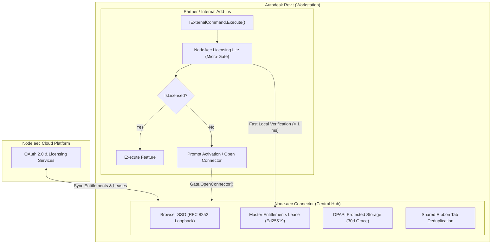

<div align="center">


# Node.aec

**Plugins, families, and templates for your BIM project.**

[Website](https://nodeaec.com.br) • [Catalog](https://nodeaec.com.br/products) • [Developer API](https://nodeaec.github.io/developer-api/) • [Instagram](https://www.instagram.com/node.aec) • [Contact](mailto:dev@nodeaec.com.br)

[](https://github.com/nodeaec/revit-connector)
[](https://github.com/nodeaec/templates-revit)
[](https://github.com/nodeaec/licensing-lite)
[](https://nodeaec.com.br)

---

</div>

## 🌐 About Node.aec

**Node.aec** is the digital distribution, marketplace, and licensing platform for the Architecture, Engineering, and Construction (AEC) industry. We bridge the gap between BIM content creators and project designers:

- ⚡ **Plugins & Automation**: Tools that eliminate repetitive modeling and documentation tasks directly from your BIM software.
- 📐 **Libraries & Families**: Production-ready, validated BIM objects and component catalogs ready to insert into projects.
- 📋 **Templates & Standards**: Project standards for architecture, structure, and MEP ready to use.
- 📚 **Guides & E-books**: Technical documentation, workflow guidelines, and BIM process management.
- 🤝 **Connections & Ecosystem**: A curated network uniting project owners, specialized consultancies, and AEC talent.

---

## 🏛️ Developer Infrastructure: Hub & Micro-Gate Architecture

Node.aec provides BIM creators with turnkey licensing and distribution infrastructure to build sustainable software businesses without developing custom licensing servers, machine DRM, or payment pipelines.

The platform decouples workstation license management from individual add-ins:



---

## 📦 Repositories & Tooling

| Repository | Description | Key Technologies |
|---|---|---|
| [`revit-connector`](https://github.com/nodeaec/revit-connector) | Central desktop governance and license manager add-in for **Autodesk Revit 2023–2027**. Implements Browser SSO (RFC 8252 loopback OAuth 2.0), DPAPI-encrypted leases, Ed25519 cryptographic verification, and shared ribbon tab management. | C#, WPF, Revit API, RFC 8252, Ed25519 |
| [`licensing-lite`](https://github.com/nodeaec/licensing-lite) | `NodeAec.Licensing.Lite` — offline license gate NuGet package. Validates the signed lease locally in 3 lines of code, with no network calls and a fail-closed design. | NuGet, .NET Framework 4.8 / .NET 8 / .NET 10, Ed25519 |
| [`templates-revit`](https://github.com/nodeaec/templates-revit) | `dotnet new nodeaec-revit-plugin` — Official template for scaffolding licensed Revit add-ins with multi-targeting (2023–2027), build matrix, and automated installer generation. | `dotnet new`, MSBuild, Inno Setup |
| [`revit-sample-plugin`](https://github.com/nodeaec/revit-sample-plugin) | Reference Revit add-in illustrating end-to-end license gating and UX integration with `NodeAec.Licensing.Lite`. | C#, Revit API, Sample Integration |
| [`developer-api`](https://github.com/nodeaec/developer-api) | Official **Node.aec Developer API** reference documentation ([live docs site](https://nodeaec.github.io/developer-api/)) and ready-to-clone CI/CD release templates (GitHub Actions, Bash, PowerShell) for automating BIM product, version, binary, and security manifest submissions. | REST API, Bearer Tokens (`aec_...`), GitHub Actions, PowerShell |

---

## 🚀 Add Node.aec licensing to a Revit add-in

Pick the path that matches where you are. Each one has a step-by-step guide for people, a
detailed guide for coding agents, and a prompt you can paste into your agent.

| You are… | Start here | For your coding agent |
|---|---|---|
| **Starting a new plugin** | [Template README](https://github.com/nodeaec/templates-revit#readme): `dotnet new nodeaec-revit-plugin` | Prompt in the template README; the generated project ships `AGENTS.md` and the skill |
| **Adding licensing to an existing plugin** | [Partner Integration Guide](https://github.com/nodeaec/revit-connector/blob/main/docs/PARTNER_INTEGRATION.md) | Prompt in the guide; skill [`licensing-integrate`](https://github.com/nodeaec/revit-sample-plugin/tree/main/.agents/skills/licensing-integrate) |
| **Learning from a working example** | [Sample Plugin README](https://github.com/nodeaec/revit-sample-plugin#readme) | Prompt in the sample README; its `AGENTS.md` |

Quick look at a new plugin:

```powershell
dotnet new install NodeAec.Templates.RevitPlugin
dotnet new nodeaec-revit-plugin -n MyPlugin --ProductSlug my-plugin
cd MyPlugin
dotnet build -p:RevitYear=2026
```

The whole licensing integration is the first lines of each paid command:

```csharp
using NodeAec.Licensing;

Snapshot gate = Gate.Validate("my-plugin"); // local check, never throws
if (!gate.IsLicensed)
{
    // The message names the reason and the next step (Portuguese or English).
    var dialog = new TaskDialog("License Required") { MainContent = gate.GetMessage(MessageLanguage.English) };
    dialog.AddCommandLink(TaskDialogCommandLinkId.CommandLink1, "Open Node.aec Connector...");
    if (dialog.Show() == TaskDialogResult.CommandLink1)
    {
        Gate.OpenConnector(); // where the user signs in or activates a key
    }
    return Result.Cancelled;
}

// Your feature runs here, only when licensed.
```

---

## 📬 Contact & Community

- 🌐 **Platform**: [nodeaec.com.br](https://nodeaec.com.br)
- 🛒 **BIM Catalog**: [nodeaec.com.br/products](https://nodeaec.com.br/products)
- 📸 **Instagram**: [@node.aec](https://www.instagram.com/node.aec)
- 💬 **Developer Inquiries**: [dev@nodeaec.com.br](mailto:dev@nodeaec.com.br)
- 🐛 **Issues & Feedback**: Open an issue in the respective [repository tracker](https://github.com/orgs/nodeaec/repositories)

<div align="center">
<sub>Built with precision for the AEC industry • Node.aec</sub>
</div>
